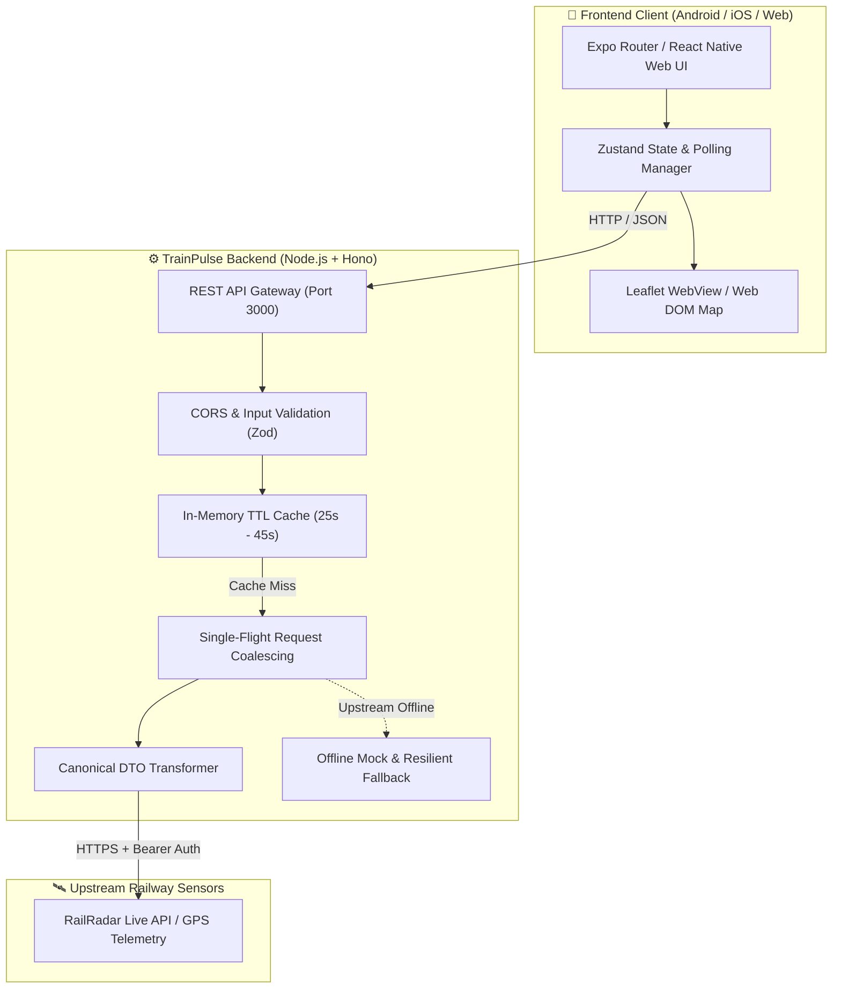

# 🚆 TrainPulse

> **Real-Time Indian Railway Live Train Tracking & Journey Companion**  
> Cross-platform application for **Android**, **iOS**, and **Web**, engineered with strict TypeScript, Expo, React Native Web, and an enterprise-grade Hono backend.

---

## 📌 Overview

**TrainPulse** provides high-precision, truthful railway telemetry across Indian Railways. Designed around transparency and reliability, the application clearly distinguishes between real satellite GPS coordinates, timetable estimations, and station departure events—ensuring passengers never mistake approximations for confirmed facts.

### Core Capabilities

- 🔍 **Where-to-Where Journey Search**: Search direct train services connecting any two Indian Railway stations with debounced station autocomplete.
- 📡 **Live Telemetry & Tracking**: Real-time status, speed, current location, next halt, arrival/departure timestamps, and delay minutes.
- 🗺️ **Interactive Live Route Map**: OpenStreetMap + Leaflet interactive railway map rendered seamlessly on Web and Mobile via Expo Go.
- 🚉 **Platform Status**: Station platform indicator clearly distinguishing **Confirmed**, **Expected**, and **Unavailable** states with freshness timestamps.
- 🚃 **Coach Composition & My Coach**: Visual rake layout (Engine → Coaches → Guard) with interactive **My Coach** selector and offline persistence.
- 🛡️ **Truthful Telemetry**: Zero invented coordinates. If GPS telemetry is unavailable from upstream sensors, it is explicitly flagged and never synthesized.

---

## 📸 Screenshots & UI Preview

> *Place application screenshots in `assets/screenshots/` and link them below.*

| Where-to-Where Search | Live Tracking & Map | Coach Layout & My Coach |
| :---: | :---: | :---: |
| *``* | *``* | *``* |

| Platform Status Card | Station Autocomplete | Desktop Responsive Mode |
| :---: | :---: | :---: |
| *``* | *``* | *``* |

---

## 🏗️ Architecture & Data Flow

TrainPulse enforces a **zero-secret frontend policy**. The client application communicates exclusively with the TrainPulse backend gateway. Upstream railway data provider credentials (`RAILRADAR_API_KEY`) remain strictly encapsulated on the server.



### Architectural Principles
1. **Frontend Secret Isolation**: Frontend bundles contain no third-party railway API keys or secrets.
2. **Single-Flight Request Coalescing**: Concurrent client queries for the same train number share a single outbound upstream request, protecting quotas.
3. **Graceful Cache Degradation**: When upstream services experience downtime or rate limits (HTTP 429/503), the backend serves stale data with an `X-Cache: STALE` header and user-facing freshness warnings.
4. **Adaptive Lifecycle Polling**: Live polling runs every 30–45 seconds and automatically pauses when the mobile app goes to background or the browser tab is hidden (`AppState` / `visibilitychange`).

---

## 🛠️ Technology Stack

| Layer | Technologies |
| :--- | :--- |
| **Mobile & Web UI** | React Native, Expo SDK 52, Expo Router, React Native Web |
| **Language** | TypeScript (strict mode enabled across all packages) |
| **State & Storage** | Zustand, `@react-native-async-storage/async-storage` |
| **Mapping Engine** | Leaflet.js, OpenStreetMap, CartoDB Voyager tiles, `react-native-webview` |
| **Validation & DTOs** | Zod schemas for runtime request/response verification |
| **Backend Server** | Node.js, Hono framework, `@hono/node-server` |
| **Testing** | Vitest, React Native testing mocks (225+ automated tests) |

---

## 🚀 Getting Started

### Prerequisites
- **Node.js** >= 18.0.0
- **npm** >= 9.0.0 (or yarn / pnpm)
- **Expo Go** application installed on iOS or Android (optional, for physical device testing)

---

### 1. Backend Setup

1. Open a terminal and navigate into the `backend` directory:
   ```bash
   cd backend
   ```

2. Install dependencies:
   ```bash
   npm install
   ```

3. Configure environment variables:
   ```bash
   cp .env.example .env
   ```
   *Edit `.env` if you have an upstream RailRadar API key. If omitted or kept as placeholder, TrainPulse operates seamlessly using the built-in offline dataset.*

4. Start the backend development server:
   ```bash
   npm run dev
   ```
   The backend will start at `http://localhost:3000`.

---

### 2. Frontend Setup (Mobile & Web)

1. Open a new terminal in the repository root:
   ```bash
   npm install
   ```

2. *(Optional)* Configure client environment:
   ```bash
   cp .env.example .env
   ```
   *(By default, the client automatically detects your computer's LAN IP when testing on physical devices via Expo Go, and uses `localhost:3000` on web).*

3. Launch Expo:
   ```bash
   npx expo start
   ```

4. Choose your target platform:
   - Press **`w`** in the terminal to launch in your default **Web Browser**.
   - Press **`a`** to open in an **Android Emulator**.
   - Press **`i`** to open in an **iOS Simulator**.
   - Scan the terminal QR code with **Expo Go** on your physical Android or iOS device.

---

## 📡 API Reference

The backend provides versioned REST endpoints (`/api/v1`):

### 1. Live Train Tracking
- **Endpoint**: `GET /api/v1/trains/:trainNumber/live`
- **Params**: `trainNumber` (5-digit numeric string, e.g. `12046`)
- **Sample Response**:
  ```json
  {
    "success": true,
    "data": {
      "trainNumber": "12046",
      "trainName": "Chandigarh Shatabdi Express",
      "status": "RUNNING",
      "currentLocation": {
        "name": "Ambala Cantt",
        "latitude": 30.33,
        "longitude": 76.84,
        "speedKmH": 85,
        "positionType": "ACTUAL_GPS"
      },
      "delayMinutes": 5,
      "nextStation": {
        "code": "KKDE",
        "name": "Kurukshetra Jn",
        "platform": "2",
        "scheduledArrival": "13:00",
        "actualArrival": "13:05"
      },
      "lastUpdatedTime": "2026-09-11T12:00:00.000Z",
      "stations": []
    }
  }
  ```

### 2. Where-to-Where Train Search
- **Endpoint**: `GET /api/v1/trains/between?from=CDG&to=NDLS`
- **Query Params**:
  - `from`: Origin station code (e.g. `CDG`)
  - `to`: Destination station code (e.g. `NDLS`)

### 3. Station Search & Autocomplete
- **Endpoint**: `GET /api/v1/stations/search?q=DELHI`
- **Query Params**:
  - `q`: Partial station code or name (minimum 2 characters)

### 4. Coach Composition
- **Endpoint**: `GET /api/v1/trains/:trainNumber/coaches`
- **Params**: `trainNumber` (5-digit numeric string)

### 5. Platform Information
- **Endpoint**: `GET /api/v1/trains/:trainNumber/platform`
- **Params**: `trainNumber` (5-digit numeric string)

---

## 🧪 Testing Suite

TrainPulse enforces comprehensive unit and integration test coverage across both frontend and backend layers.

### Run Frontend Tests
```bash
# In repository root
npm test
```
*Executes 13 test suites covering station autocomplete, debouncing, truthful coordinate normalization, Leaflet map generation, coach selection, platform cards, and responsive layout constraints (132+ passing tests).*

### Run Backend Tests
```bash
# In backend directory
cd backend
npm test
```
*Executes 10 test suites covering route handlers, Zod schema validation, upstream timeout handling (8s limit), single-flight request coalescing, cache TTL expiration, and secret sanitization (93+ passing tests).*

### Typecheck Verification
```bash
# Root TypeScript check
npm run typecheck

# Backend TypeScript check
cd backend && npm run typecheck
```

---

## 🔒 Security & Secrets Hygiene

- **`.env` Ignored**: All environment variable files (`.env`, `.env.*`, `*.env`) are strictly excluded from version control.
- **Error Sanitization**: Backend error handlers redact authorization headers, tokens, and upstream keys prior to logging or returning responses to clients.
- **Zero Client Leakage**: The client code contains zero references to private upstream API keys.

---

## 📄 License

This project is licensed under the MIT License - see the [LICENSE](LICENSE) file for details.

