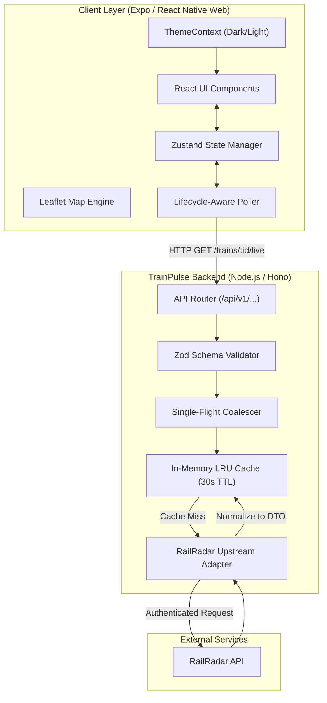

# TrainPulse - System Architecture Document

## 1. System Overview
TrainPulse operates on a strictly decoupled client-server architecture. The frontend handles cross-platform UI, map rendering, and local state management. The backend acts as a secure proxy and data transformer to the external RailRadar API. 

## 2. Technology Stack
* **Frontend:** TypeScript, React Native, Expo, Expo Router, React Native Web, Zustand (State), Zod (Validation), Leaflet (Map via react-native-webview/Web DOM).
* **Backend:** Node.js, Hono, Zod, lru-cache (In-memory caching).
* **Shared:** A monorepo package (`@trainpulse/shared`) containing Zod DTOs for strict type synchronization.
* **Upstream:** RailRadar API.
* **Persistence:** (Deferred for MVP) Supabase is reserved for future milestones if persistent user data is needed.

## 3. High-Level Architecture Diagram

## 4. Key Architectural Decisions

### 4.1. Map Rendering Strategy
To ensure 100% Expo Go compatibility and zero native build step requirements, `react-native-maps` is avoided. Instead, we use an OpenStreetMap/Leaflet implementation:
* **Mobile:** Rendered inside a `react-native-webview`.
* **Web:** Rendered directly in the browser DOM.

### 4.2. Request Coalescing & Caching
Because TrainPulse auto-polls every 30 seconds, high traffic can overwhelm upstream providers.
* **Coalescing:** If 50 users poll train `12046` simultaneously, the backend halts 49 requests, makes 1 outbound request to RailRadar, and broadcasts the result to all 50 clients.
* **TTL Cache:** Successful responses are held in memory for 30-45 seconds.

### 4.3. Data Flow & Transformation
Clients never see raw upstream data. The backend adapter parses the RailRadar JSON, maps it to the `@trainpulse/shared` DTO (`LiveTrainData`), strictly types the response, and sends the sanitized payload to the client.

### 4.4. Dynamic Theming
Theme changes (Dark/Light) trigger dynamic re-evaluation of `StyleSheet.create` calls via a `useTheme()` context hook. This prevents static styles from locking into one mode upon app initialization.

## 5. Security Architecture
* **Zero Trust Frontend:** No API keys are bundled into the client. The frontend does not even know RailRadar exists.
* **Environment Secrets:** `RAILRADAR_API_KEY` is loaded strictly via `.env` in the backend.
* **Error Sanitization:** All upstream 5xx errors or auth failures are caught by a global Hono error handler. Stack traces and upstream HTTP messages are sanitized before returning a generic 502/503 to the client.

## 6. Deployment & Scalability
* **Backend:** Can be deployed to lightweight containers or serverless edge environments (e.g., Vercel, Cloud Run) that support Hono.
* **Frontend:** Deployed as Static Web Assets for the browser, and via Expo EAS for Android (APK/AAB) and iOS (IPA).
